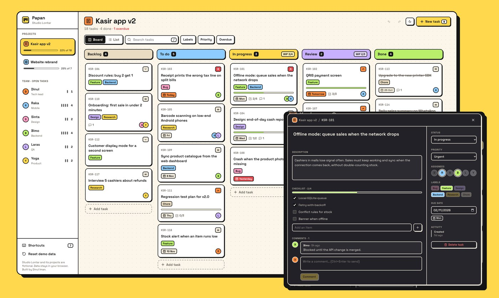

# Papan: project board

[](https://github.com/dinulimann/papan-board/actions/workflows/ci.yml)

**Live demo:** https://papan-board.vercel.app



A kanban board for **Studio Lontar**, a fictional product studio with two projects. It is a UI showcase in a bold, flat style with thick outlines and hard shadows. There is no backend: the sample tasks are created in your browser and every change is saved in `localStorage`.

Built with **React 19**, **TypeScript** (strict), **Vite**, **Tailwind CSS 4**, **Motion** and **dnd-kit**, tested with **Playwright**.

## What is in it

- **Drag and drop** between and within five columns, with a tilted drag preview and a small burst when a card lands in Done. Touch works with a short press. **Keyboard works too:** focus a card, press <kbd>Space</kbd>, move with the arrow keys (left and right jump between columns), press <kbd>Space</kbd> to drop. Screen readers hear which task was picked up and where it went.
- **Work-in-progress limits** on In progress and Review. A column over its limit turns striped and says so.
- **Undo and redo** for every change (<kbd>⌘Z</kbd>, <kbd>⌘⇧Z</kbd>, or the toast's Undo button), up to 50 steps.
- **Quick add** that understands `#label`, `@person`, `!priority` and `^due`, for example `Fix receipt tax #bug @raka !urgent ^fri`, with a live preview of what it read.
- **Task detail:** editable title and description, checklist with progress, comments, assignees, labels, priority, due date and an activity log. The open task is in the URL, so a link opens it.
- **Filters** by person, label, priority, overdue and text search, all kept in the URL. The sidebar shows each person's open tasks.
- **List view** with sorting and a status menu on every row.
- Light and dark mode, keyboard shortcuts (<kbd>N</kbd>, <kbd>/</kbd>, <kbd>B</kbd>, <kbd>L</kbd>, <kbd>?</kbd>), focus-trapped dialogs, a phone layout with swipeable columns, and reduced motion respected.

## Tests

Twelve Playwright tests run on every push. Nine use the browser against the production build: drag with the mouse then undo and redo, move a card with the keyboard only, WIP limit warnings, quick add, editing a task, filters that survive a reload, delete then undo, dark mode and shortcuts. Three check the quick-add parser directly (weekdays, relative and ISO dates, unknown tokens left in the title). Every browser test also fails on any console error.

## Run it

Requirements: Node.js 22.

```bash
npm ci
npm run dev          # http://localhost:5173
npm run test:e2e     # builds, serves on :5202 and runs Playwright
```

## Structure

```
src/lib/store.tsx        reducer, undo/redo history, localStorage, toasts
src/lib/quickadd.ts      quick-add parser
src/lib/seed.ts          sample projects and tasks
src/lib/router.ts        hash routes and URL filters
src/components/Board.tsx drag and drop, WIP limits, keyboard moves across columns
src/components/          task card, task detail, list view, quick add, shared UI
tests/                   Playwright tests
```

Studio Lontar and its projects are not real. Built by Dinul Iman.
